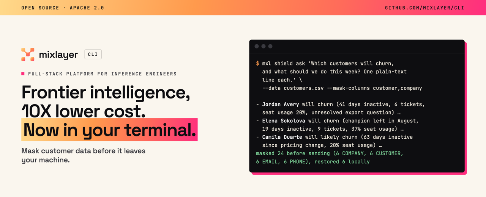
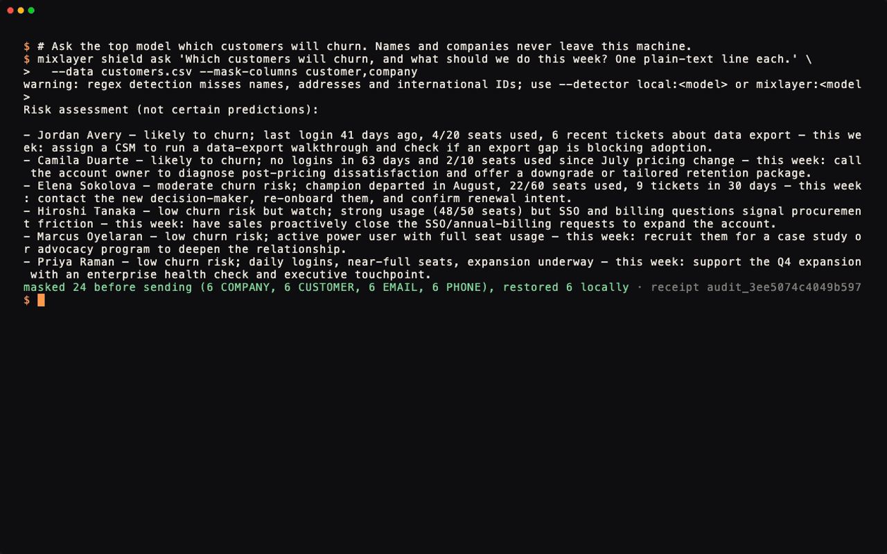

<p align="center"></p>

# Mixlayer CLI

[](https://github.com/mixlayer/cli/actions/workflows/ci.yml)
[](LICENSE)

The official command-line tool for [Mixlayer](https://mixlayer.com). Run open models like DeepSeek, Qwen and GLM from your terminal, see what every answer costs, and give your coding agent the same access. Written in Rust, with builds for macOS, Linux and Windows.

```sh
mixlayer ask "Explain the CAP theorem in two sentences"
```

## Quick start

```sh
curl -fsSL https://github.com/mixlayer/cli/releases/latest/download/install.sh | sh
export MIXLAYER_API_KEY="your-key"      # from https://console.mixlayer.com/app/api-keys

mixlayer models list --live-prices      # what you can call, and what it costs
mixlayer ask "Explain the CAP theorem in two sentences"
```

It works like any other model CLI from there. The rest of this page covers what it does beyond the API call.

## Beyond the API call

**Pay for the model the question needs.** `escalate` starts on the cheapest model and moves up only when the answer is unsure. `compare` runs a cheap and a frontier model on your prompt and prices the difference, and `savings` totals what your real usage would have cost at frontier prices.

**Compare models side by side.** `ladder` runs one prompt across several models and shows each answer with its latency, tokens and cost. `council` asks several models and has a judge reconcile them.

**Run your account from the terminal.** `whoami` shows what your key can do, `keys mint` gives one job its own short-lived key, `spend --fail-over 5` stops a script when usage passes $5, `budget set` caps monthly spend, and `audit --follow` shows account changes as they happen.

**Remember every run.** Each call lands in a local SQLite ledger. `grep` searches old answers, `replay` re-runs a prompt with the same model and seed to check drift, and `sql` queries your spend.

**Mask private data for any model.** `shield ask` swaps names, emails, phone numbers and IDs for placeholders, sends the masked prompt, and restores the real values in the answer on your machine. It works with Mixlayer, OpenAI, Anthropic, OpenRouter or your own endpoint. Mixlayer itself runs with [zero data retention](https://docs.mixlayer.com/zero-data-retention) by default.

### Built for agents

Give your agent the Mixlayer skill so it knows how to use the CLI:

| Agent | Install the skill |
| --- | --- |
| Hermes | `hermes skills install mixlayer/cli/skills/mixlayer` |
| Claude Code | `npx skills add mixlayer/cli --skill mixlayer -g -a claude-code -y` |
| Codex, Cursor and others | `npx skills add mixlayer/cli --skill mixlayer -g -y` |
| Any of the above, plus the MCP server | `mixlayer agent setup --agent all --yes` |
| Also let the agent manage your account (keys, usage, billing) | `mixlayer agent setup --agent claude-code --platform --yes` |

Then ask your agent something like "use mixlayer to find the cheapest model that answers this prompt as well as GLM".

`mixlayer agent setup` installs an Agent Skill and an MCP server into Claude Code, Codex, Cursor, Hermes or Claude Desktop, without writing your key into their config. Every command takes `--agent` (JSON on stdout, no prompts) and `--dry-run` (show the exact request without sending it), and returns [exit codes](#exit-codes) a script can branch on. `agent-context` lists every command and flag as JSON, and `which "compare models"` finds the right command for a task.

## Contents

- [Install](#install)
- [Get started](#get-started)
- [Pick a model](#pick-a-model)
- [Compare models and cut cost](#compare-models-and-cut-cost)
- [Keep personal data out of prompts](#keep-personal-data-out-of-prompts)
- [Your local ledger](#your-local-ledger)
- [Scripts and CI](#scripts-and-ci)
- [Coding agents and MCP](#coding-agents-and-mcp)
- [Configuration](#configuration)
- [Exit codes](#exit-codes)
- [Development](#development)

## Install

On macOS or Linux:

```sh
curl -fsSL https://github.com/mixlayer/cli/releases/latest/download/install.sh | sh
```

The script downloads the right build for your machine, checks it against the release checksums and puts `mixlayer` and `mixlayer-mcp` in `~/.local/bin` (set `MIXLAYER_INSTALL_DIR` to change that).

On Windows, or to install by hand, download the archive for your platform from [Releases](https://github.com/mixlayer/cli/releases), unpack it and put both binaries on your `PATH`. Builds cover macOS (Apple silicon and Intel), Linux (x86-64 and ARM64, statically linked) and Windows (x86-64 and ARM64).

With a Rust toolchain you can also build from source:

```sh
cargo install --locked --git https://github.com/mixlayer/cli
```

Check the install:

```sh
mixlayer version
```

For tab completion, add the script for your shell (`bash`, `zsh`, `fish` or `powershell`), for example:

```sh
mixlayer completion zsh > "${fpath[1]}/_mixlayer"
```

Every command and subcommand is listed in the [command reference](skills/mixlayer/references/commands.md), which is generated from the CLI itself. Add `--help` to any command for the details.

## Get started

1. Create an API key in the [Mixlayer console](https://console.mixlayer.com/app/api-keys). `mixlayer auth setup --launch` opens that page for you.
2. Give the CLI your key. Either export it:

   ```sh
   export MIXLAYER_API_KEY="your-key"
   ```

   or save it once to the CLI's private credentials file (mode 0600) by piping it in, which keeps it out of your shell history:

   ```sh
   pbpaste | mixlayer auth set-token
   ```

3. Check that everything is wired up:

   ```sh
   mixlayer doctor
   ```

   `doctor` reports whether the key is set, whether the API is reachable, and where the CLI keeps its config and data. It never prints the key.

4. Ask something:

   ```sh
   mixlayer ask "Write a haiku about cache invalidation"
   ```

   Without `--model`, the CLI picks the highest-priced active model in your live catalog. The answer prints to stdout, and the prompt, answer, token counts and cost go into the local ledger.

For raw API access with every OpenAI parameter, use `chat`:

```sh
mixlayer chat --model <model-id> --messages '[{"role":"user","content":"Hello"}]' --temperature 0.2 --max-tokens 200
```

## Pick a model

```sh
mixlayer models list                      # model IDs available to your key
mixlayer models list --live-prices        # adds status and price per 1M tokens (JSON adds context size, tools, modalities)
mixlayer models query "ctx>=128k tools"   # filter the cached catalog
```

Prices come from your organization's live catalog and are cached locally for an hour. Pick model IDs from this list rather than hard-coding them, because the lineup changes.

## Compare models and cut cost

Run the same prompt across several models and see answers, latency, tokens and cost side by side:

```sh
mixlayer ladder "Summarize this stack trace: ..." --rungs <model-a>,<model-b>,<model-c>
```

Start with the cheapest model and move up only when the answer looks unsure:

```sh
mixlayer escalate "Classify this ticket as bug, feature or question: ..." --confidence 0.85
```

Ask several models, then have a judge model reconcile them and flag disagreements:

```sh
mixlayer council "Which of these migration plans is safest? ..." --members <model-a>,<model-b> --judge <model-c>
```

Check whether a cheap model is good enough for a task, and what you'd save:

```sh
mixlayer compare "Extract the invoice total from: ..." --cheap <small-model> --frontier <large-model>
mixlayer savings --vs gpt-frontier
```

`savings` totals your ledger's real spend against what the same tokens would cost on a frontier model.

## Keep personal data out of prompts

`shield` finds personal data (names, emails, phone numbers, card numbers, IDs), swaps it for placeholders like `EMAIL_12b5f8de`, sends only the masked text, and puts the real values back into the answer on your machine. The mapping lives in a local vault and never leaves it.

Mixlayer doesn't keep your requests ([zero data retention](https://docs.mixlayer.com/zero-data-retention)). Shield covers everything else: other providers, other retention policies, or any time you'd rather a model never see a real name.

<p align="center"></p>

That demo is a real run on a synthetic customer list ([docs/demo/customers.csv](docs/demo/customers.csv)). The model saw `CUSTOMER_e993684a` and `COMPANY_293a7f63`, never the real values, and the CLI put the names back into the answer locally.


See exactly what the model will get, without sending anything:

```sh
mixlayer shield redact customers.csv --mask-columns customer,company
```

Then ask. `--mask-columns` masks every value in the columns you name, on top of the detector, which suits exports where you know which fields are private:

```sh
mixlayer shield ask "Which customers will churn, and what should we do this week?" \
  --data customers.csv --mask-columns customer,company --show-sent
```

`--show-sent` prints the masked request after the answer. Shield works with Mixlayer or any other provider:

```sh
mixlayer shield ask "Draft a follow-up email" --data customers.csv --upstream openai --model gpt-4o --detector local:llama3.1:8b
```

Before every send, shield scans the masked payload again and stops with exit code 6 if anything still looks personal.

Other shield commands:

```sh
mixlayer shield scan export.csv --max-risk 0        # fail (exit 6) if the file contains PII; no network
mixlayer shield redact export.csv -o masked.csv     # write a masked copy
mixlayer vault rehydrate masked-answer.txt          # put real values back, locally
mixlayer shield audit                               # receipts: what was sent, to whom, and how much was masked
mixlayer shield eval --sample testdata/shield-eval/synthetic.jsonl --detector regex
```

### Pick a detector

| Detector | What it does | Use it when |
| --- | --- | --- |
| `regex` (default) | Pattern matching on your machine | Emails, phones, cards and IDs. It misses many names and addresses. |
| `local:<model>` | A local model (e.g. Ollama at `localhost:11434`) finds entities on top of regex | Free text with names, sent to a provider you don't control |
| `mixlayer:<model>` | A Mixlayer model finds entities | You're fine sending raw text to Mixlayer once for detection (covered by zero data retention) |

Regex alone is a floor, not a guarantee. Sending to a non-Mixlayer provider with regex only requires `--accept-regex-only`, so that choice is explicit. Run `shield eval` on samples that look like your data to measure recall before you rely on it.

## Your local ledger

`ask`, `ladder`, `escalate`, `council`, `compare` and `shield ask` save every run locally.

```sh
mixlayer grep "migration" --limit 10              # full-text search over prompts, answers and reasoning
mixlayer replay <run-id>                          # re-run with the same model and seed to check drift
mixlayer sql "select model, count(*), sum(cost_usd) from runs group by model"
mixlayer sql "select * from runs order by created_at desc limit 100" --json > recent-runs.json
```

`sql` is read-only. Shield runs store only the masked prompt that was actually sent. The original values live in a separate local vault that agent-mode `sql` and the MCP server refuse to read; use `mixlayer vault rehydrate` yourself when you need them.

## Scripts and CI

Add `--agent` to any command to get JSON on stdout with no prompts and no color. Use `--select` to keep only the fields you need and `--dry-run` to see a request without sending it.

```sh
mixlayer models list --agent --select id
mixlayer ask "Is this commit message clear? ..." --model <model-id> --agent | jq -r .answer
```

Use exit codes in pipelines instead of parsing error text. For example, block a commit that contains personal data:

```sh
mixlayer shield scan fixtures/users.json --max-risk 0 --agent || exit 1
```

`--agent` turns on automatically when the CLI detects Claude Code, Codex, Cursor or Gemini CLI. Set `MIXLAYER_NO_AGENT_DETECT=1` to turn that off.

## Coding agents and MCP

The CLI ships with an [Agent Skill](skills/mixlayer/SKILL.md) and an MCP server (`mixlayer-mcp`). One command installs both into your agents:

```sh
mixlayer agent setup --agent claude-code          # preview what would change
mixlayer agent setup --agent claude-code --yes    # install
mixlayer agent setup --agent all --uninstall --yes
```

Targets are `claude-code`, `codex`, `cursor`, `hermes`, `claude-desktop` or `all`. Setup backs up files it edits and never writes your API key into agent config; keep `MIXLAYER_API_KEY` in the environment the agent runs in.

After you upgrade the CLI, run `mixlayer agent setup --agent all --yes` again so your agents get the new skill. Setup updates any skill it installed that you haven't edited, and leaves edited copies alone. `mixlayer doctor` lists each installed skill as `current`, `outdated` or `modified`. The MCP server needs no update step: its tools come from the binary you just installed.

The MCP server gives agents typed tools for the API (`chat_create_completion`, `models_list`, `models_get`) and workflow tools for everything above: `ask`, `ladder`, `escalate`, `shield_ask`, `shield_redact`, `shield_scan`, `shield_audit`, `shield_eval`, `grep`, `sql`, `savings`, `models_query` and `doctor`. A `context` tool hands the agent the embedded skill first, so it learns to check live models, preview with `dry_run`, and route personal data through `shield_ask`.

Some things stay off MCP on purpose: the vault and the shield dictionary (they hold your original private values), `vault` commands, `agent setup` and `keys`. Agents send what they read to a remote model, so those stay on your machine.

### Manage your account from your agent

Mixlayer also hosts an MCP server for the Platform API at `https://api.mixlayer.com/v1/mcp`. With it, your agent can list and create API keys, check usage and spend, manage members and read invoices. Add `--platform` to setup:

```sh
mixlayer agent setup --agent claude-code --platform --yes
```

The agent authenticates with the key in `MIXLAYER_API_KEY` (or the variable you name with `--key-env`), and that key needs the `api-read` permission. If the variable is set, setup checks the key before it changes anything. The tools, the permissions and the config for each agent are in [docs/platform-mcp.md](docs/platform-mcp.md).

The same key operations work from the terminal:

```sh
mixlayer keys list
mixlayer keys create --name ci --permissions inference   # prints the new secret once
mixlayer keys rotate <key-id> --yes
```

### Your account from the terminal

```sh
mixlayer whoami --agent                                  # key source, organization and permissions
mixlayer keys mint --ttl 30m -- mixlayer models list      # give one job a temporary key
mixlayer spend --range current --fail-over 5 --agent     # exit 9 when gross usage exceeds $5
mixlayer budget set --monthly-limit 25 --warn-at 20 --yes
mixlayer audit --since 24h --follow
```

Minted keys expire on the server and are deleted when the job ends. Inference may keep accepting a deleted key for up to a minute while the gateway cache refreshes. `budget set` limits are monthly; reaching the limit pauses paid model traffic until it resets or is raised.

Agents can also discover the CLI directly:

```sh
mixlayer agent-context            # every command, flag and exit code as JSON
mixlayer which "compare models"   # find the command for a task
mixlayer agent skill print        # read the embedded skill
```

To build the Claude Desktop bundle, run `scripts/mcpb.sh`.

## Configuration

| Variable | Purpose |
| --- | --- |
| `MIXLAYER_API_KEY` | Your API key (required for API calls) |
| `MIXLAYER_BASE_URL` | API base URL. Default `https://mixlayer.ai/v1` |
| `MIXLAYER_PLATFORM_URL` | Platform API for `keys`, live prices and the Platform MCP server. Default `https://api.mixlayer.com` |
| `MIXLAYER_HOME` | Put config, data, state and cache under one directory (same as `--home`) |
| `MIXLAYER_CONFIG` | Path to the config file |
| `MIXLAYER_NO_AGENT_DETECT` | Set to `1` to stop automatic `--agent` mode |

By default the CLI follows your platform's standard locations (`~/.config/mixlayer`, `~/.local/share/mixlayer` and so on, or the XDG variables if set). `mixlayer doctor` prints the resolved paths.

You can save global flags under a name and reuse them, which helps scheduled jobs run the same way every time:

```sh
mixlayer profile save ci --agent --timeout 60s
mixlayer models list --profile ci
```

## Exit codes

| Code | Meaning | What to do |
| --- | --- | --- |
| 0 | Success | |
| 1 | Other failure | Read the error |
| 2 | Bad command or argument | Fix the arguments; retrying won't help |
| 3 | Not found (HTTP 404, or unknown model) | Check the ID with `mixlayer models list` |
| 4 | Authentication or permission (HTTP 401/403) | Check `MIXLAYER_API_KEY` |
| 5 | Other API error | Inspect the response; retry if it's a 5xx |
| 6 | Partial failure, or PII found by `shield scan`/the shield tripwire | Inspect per-item results or the receipt |
| 7 | Rate limited (HTTP 429) | Wait for `Retry-After`; the CLI already retries |
| 8 | Billing or no prepaid credit (HTTP 402) | Add credit; the CLI does not retry |
| 9 | Decision gate matched (experimental) | Inspect the printed answer |
| 10 | Configuration error | Fix the config file or paths |

## Development

```sh
git clone https://github.com/mixlayer/cli && cd cli
cargo build --release   # target/release/mixlayer and mixlayer-mcp
cargo test              # unit, parity and integration tests, offline
```

The end-to-end suite in `parity/e2e` runs the release binary as a black box against a local fake API, and against the real API with `-tags live` (free models only). It needs Go:

```sh
cd parity/e2e
go test .                                       # local fake API, no key
MIXLAYER_API_KEY=... go test -tags live .       # real API, free models only
```

See [CONTRIBUTING.md](CONTRIBUTING.md). Report security issues privately as described in [SECURITY.md](SECURITY.md).

## License

Apache-2.0. See [LICENSE](LICENSE).
